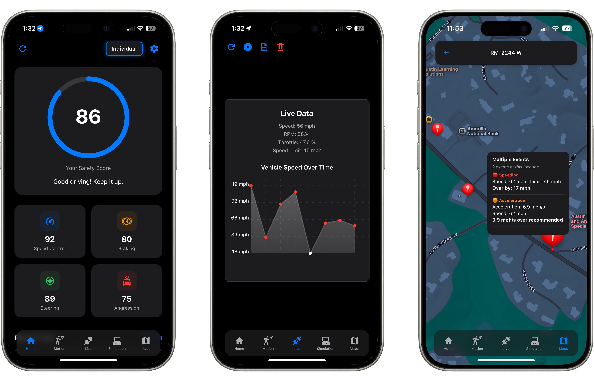

<p align="center">
  
</p>

<p align="center">
  Una aplicación que se conecta al puerto OBD-II de tu vehículo para registrar los hábitos de conducción, evaluar el rendimiento y ayudarte a conducir de manera más inteligente.
</p>

## Capturas de pantalla

<p align="center">
  
</p>

## Estructura de la base de código

```
├── src/                   // Main application source code
│   ├── assets/            // Static assets, images, and resources
│   ├── screens/           // Main application screens/views
│   ├── services/          // Logic and API services
│   ├── contexts/          // React Context providers
│   ├── utils/             // Utility functions and helpers
│   ├── hooks/             // Custom React hooks
│   ├── constants/         // Application constants and configurations
│   └── App.js             // Root application component
├── app.json               // Expo app configuration
├── index.js               // Appglication entry point
└── package.json           // Project dependencies and scripts
```

## 🎯 Objetivo del proyecto

Una vez completado, este proyecto será una aplicación móvil completa que:

- **Se conecta sin interrupciones** al puerto OBD‑II de cualquier vehículo (vía Bluetooth o Wi‑Fi) para capturar telemetría en tiempo real del motor y la conducción.
- **Evalúa continuamente** métricas clave de conducción (por ejemplo, aceleraciones bruscas, frenados repentinos, giro en curvas, cumplimiento de velocidad) y calcula una puntuación de seguridad fácil de entender para cada viaje.
- **Proporciona recomendaciones prácticas** mediante visualizaciones interactivas: mapas de calor de zonas problemáticas, resúmenes de viajes y gráficos de tendencias, para que los conductores (o los padres de adolescentes que conducen) puedan identificar y corregir comportamientos de riesgo.
- **Ofrece un panel para padres** que:
  - Resalta las zonas problemáticas recurrentes en un mapa
  - Envía alertas personalizables por eventos de conducción fuera de límites
  - Rastrea el progreso de un adolescente a lo largo del tiempo con comparaciones de puntuaciones históricas
- **Admite un modo de vista previa de seguros** (opcional) que permite a las personas simular cómo su puntuación de conducción se traduciría en tarifas basadas en el uso, antes de invertir en una póliza de telemática completa.
- **Está diseñado para ser extensible**, de modo que futuras mejoras (gamificación, tablas de clasificación sociales, sugerencias de formación automatizadas, etc.) puedan agregarse con el mínimo esfuerzo.

Con estas funciones, el producto final empoderará a los padres para orientar a sus hijos adolescentes y ayudará a todos los conductores a desarrollar hábitos más seguros.

## Errores / Mejoras de funciones

- ✅ Procesamiento asíncrono de ubicación
- ✅ Marcadores de pins de eventos
- ✅ Monitoreo en segundo plano
- ✅ Configuración automática de OBD
- ✅ Lecturas de dirección desde sensores del teléfono
- ✅ Servicio explícito en segundo plano
- 🟨 Consejos de conducción?
- ✅ Pins con código de color para diferentes eventos
- 🟨 Integración / FW personalizado para una mayor optimización
- 🟨 Desgloses de puntuación individual
- 🟨 Limpieza de estilos
- Soporte OBD de terceros
- ✅ Rutas (agrupación de viajes)
- Conexión Bluetooth (en lugar de wifi)
- Cuentas / Compartir datos
- Sitio web??
